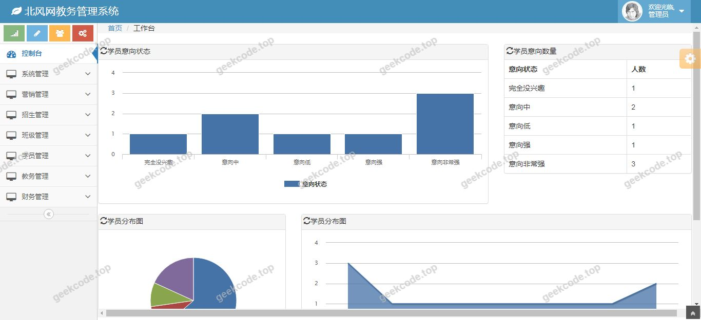
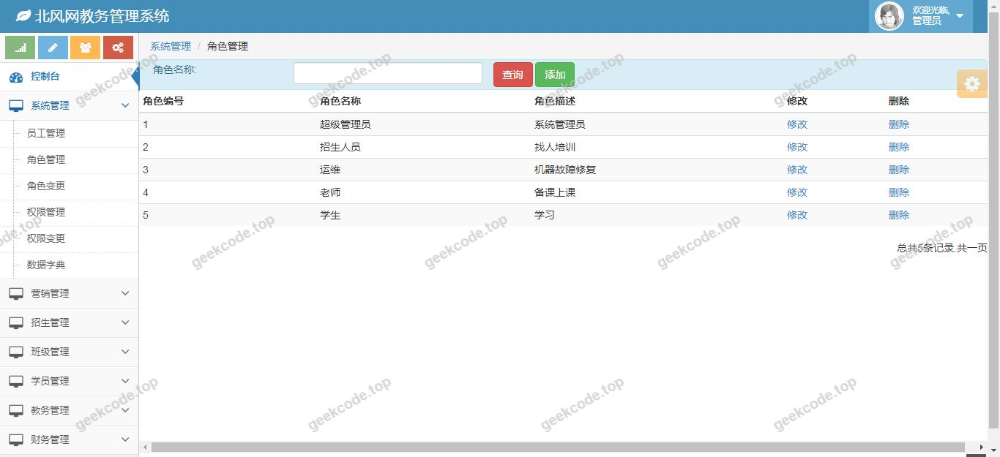
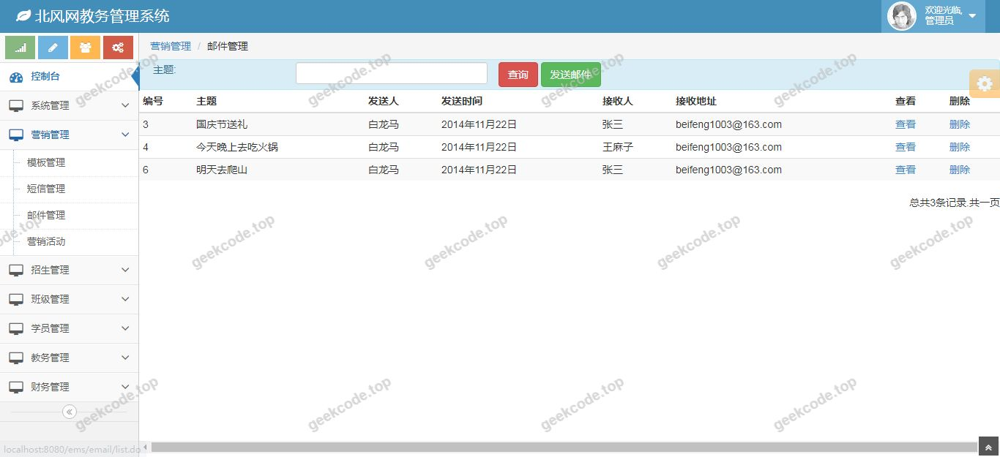
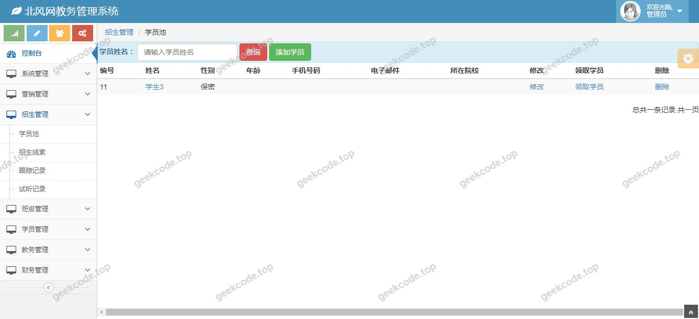
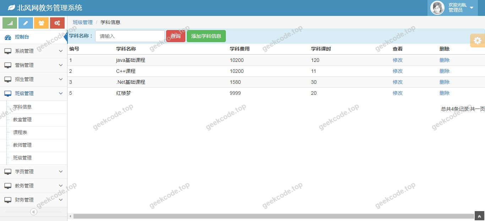
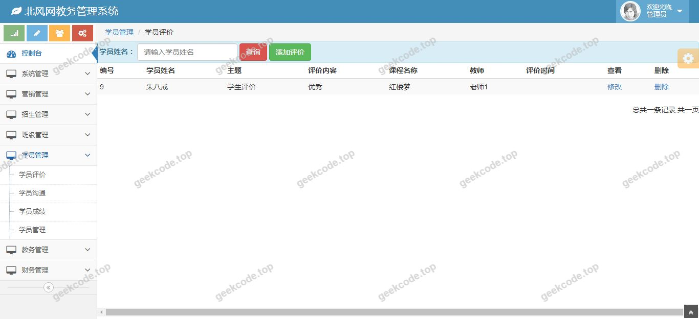
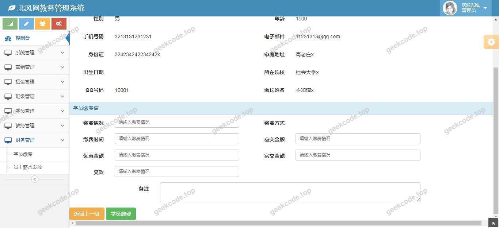

# java精品项目-培训教务管理系统

> 🎓 **计算机毕业设计 · java精品项目-培训教务管理系统**
>
> 本仓库只放**项目介绍 + 运行截图**（截图是站点带水印的原图，存在仓库 `images/` 里）。
>
> 👉 **完整可运行源码 / 数据库脚本 / 部署文档：[点我获取](https://geekcode.top/archives/java%E7%B2%BE%E5%93%81%E9%A1%B9%E7%9B%AE-%E5%9F%B9%E8%AE%AD%E6%95%99%E5%8A%A1%E7%AE%A1%E7%90%86%E7%B3%BB%E7%BB%9F?utm_source=github)**
>
> 💬 咨询微信：**ir9372**　|　🌐 更多项目：[极客代码 geekcode.top](https://geekcode.top/?utm_source=github)
>
> 📌 项目详情页：<https://geekcode.top/archives/java%E7%B2%BE%E5%93%81%E9%A1%B9%E7%9B%AE-%E5%9F%B9%E8%AE%AD%E6%95%99%E5%8A%A1%E7%AE%A1%E7%90%86%E7%B3%BB%E7%BB%9F?utm_source=github>

<table><td width="230" align="center"> <b>扫码加微信 ir9372</b></td><td valign="middle">📦 源码 = 项目介绍 + 全部运行截图 + 数据库 + 部署文档 👉 点上方任意截图，直接跳到 <b>极客代码 geekcode.top</b> 详情页</td></table>

---

<h1>java精品项目-培训教务管理系统</h1>
<h2>项目概述</h2>

本项目为“java精品项目-培训教务管理系统”，旨在构建一个基于 Java Web 技术的教育培训机构管理解决方案。系统核心目标是实现教务流程的数字化与规范化，主要服务于中小型培训机构的管理员、教师及学员群体。通过该系统，机构可高效完成课程安排、人员管理及基础数据维护等工作。技术架构上，项目采用经典的 SSM（Spring + Spring MVC + MyBatis）框架体系，前端界面使用 JSP 技术进行动态渲染，后端逻辑处理依托于 Java 生态成熟组件，确保系统的稳定性与可维护性。虽然元数据显示无明确的前后台路由分类，但根据“系统运行界面”截图推断，系统具备完整的业务操作入口，能够覆盖日常教务管理的核心场景，适用于需要轻量级、低成本部署的教育信息化环境。

<h2>技术架构</h2>

本系统采用分层架构设计，严格遵循 MVC 设计模式，以确保代码的高内聚低耦合。

<ol>
<li><strong>表现层</strong>：使用 JSP (JavaServer Pages) 技术结合 HTML/CSS/JavaScript 构建用户界面。JSP 页面负责数据的展示与用户交互事件的捕获，通过 EL 表达式和 JSTL 标签库简化页面开发。</li>
<li><strong>控制层</strong>：基于 Spring MVC 框架。Controller 类接收 HTTP 请求，解析参数，调用 Service 层处理业务逻辑，并返回视图名称或 JSON 数据。DispatcherServlet 作为前端控制器，统一调度请求分发。</li>
<li><strong>业务层</strong>：由 Spring Framework 提供 IoC（控制反转）和 AOP（面向切面编程）支持。Service 接口及其实现类封装核心业务规则，如事务管理、权限校验等，通过注解配置 Bean 的生命周期。</li>
<li><strong>持久层</strong>：采用 MyBatis 框架进行数据库交互。Mapper 接口定义 SQL 映射，XML 配置文件编写具体的 CRUD 语句，实现对象与关系型数据库之间的自动转换。</li>
<li><strong>数据存储</strong>：底层依赖 MySQL 数据库存储教务信息、用户信息及课程数据。MyBatis 通过 JDBC 连接池与数据库通信，保证数据访问的高效与安全。</li>
</ol>

这种 SSM 组合是 Java Web 开发中极为成熟的方案，适合毕业设计场景，既体现了对企业级框架的理解，又避免了过度复杂的微服务架构带来的部署难度。

<h2>功能模块</h2>

根据提供的系统运行界面截图及项目类型描述，本系统主要包含以下功能模块。由于元数据未提供详细的路由列表，以下模块基于“培训教务管理”的通用需求及可见的系统界面进行归纳：

<h3>1. 系统登录与身份验证模块</h3>
<ul>
<li><strong>功能描述</strong>：提供统一的入口界面，用户需输入账号密码进行身份认证。系统根据登录用户的角色跳转至相应的操作主界面，确保非法用户无法访问内部数据。</li>
</ul>
<h3>2. 教务信息管理模块</h3>
<ul>
<li><strong>功能描述</strong>：这是系统的核心部分，涵盖对培训机构基础资源的维护。</li>
<li><strong>课程管理</strong>：支持课程的添加、修改、删除及查询功能，记录课程名称、学时、授课教师等信息。</li>
<li><strong>班级管理</strong>：管理班级基本信息，包括班级名称、所属课程、开班时间等，并可关联查看该班级下的学员名单。</li>
</ul>
<h3>3. 人员管理模块</h3>
<ul>
<li><strong>功能描述</strong>：针对系统中的各类用户主体进行管理。</li>
<li><strong>教师管理</strong>：录入和维护教师个人信息，包括姓名、联系方式、擅长科目等，用于后续排课关联。</li>
<li><strong>学员管理</strong>：登记学员基本信息，处理报名状态，支持按条件检索学员档案。</li>
</ul>
<h3>4. 数据统计与报表模块</h3>
<ul>
<li><strong>功能描述</strong>：基于数据库中的教务数据进行简单的统计展示。例如，当前在训人数、开设课程总数等关键指标概览，辅助管理者快速掌握机构运营状况。</li>
</ul>

<em>(注：具体子功能的详细字段依据实际数据库表结构而定，此处仅列出可见的主要业务板块)</em>

<h2>用户角色与权限</h2>

尽管元数据中未显式列出角色清单，但作为一个典型的教务管理系统，通常涉及以下三类核心角色。各角色的权限划分如下：

<table>
<thead>
<tr>
<th align="left">角色</th>
<th align="left">权限描述</th>
<th align="left">可访问模块</th>
</tr>
</thead>
<tbody><tr>
<td align="left"><strong>超级管理员</strong></td>
<td align="left">拥有系统最高权限，负责全局配置与数据维护。</td>
<td align="left">1. <strong>系统设置</strong>：修改管理员账号、重置密码。2. <strong>全部数据管理</strong>：增删改查所有课程、班级、教师、学员信息。3. <strong>日志查看</strong>：监控系统操作记录。</td>
</tr>
<tr>
<td align="left"><strong>教务管理人员</strong></td>
<td align="left">负责日常教学资源的组织与维护，不具备系统底层配置权。</td>
<td align="left">1. <strong>课程管理</strong>：创建新课、调整课程计划。2. <strong>班级管理</strong>：分配学员到班级，设定班级属性。3. <strong>教师管理</strong>：更新教师资料，协助排课。4. <strong>学员管理</strong>：审核报名，完善学员档案。</td>
</tr>
<tr>
<td align="left"><strong>教师</strong></td>
<td align="left">专注于自身授课任务及相关学员信息的查看，权限受限。</td>
<td align="left">1. <strong>我的课程</strong>：查看所授课程的时间表和内容。2. <strong>我的学员</strong>：查看本班学员的基本联系信息和出勤记录（若系统支持）。3. <strong>个人信息</strong>：修改自己的联系电话等非敏感信息。</td>
</tr>
</tbody></table>

<em>说明：若系统仅面向单一管理员使用，则上述角色可能合并为一个具有全量权限的操作者。根据现有截图，系统界面呈现为单窗口操作模式，推测主要以管理员视角为主。</em>

<h2>项目特色与创新点</h2>
<ol>
<li><strong>经典稳定的技术选型</strong>：采用 SSM 框架而非新兴的微服务或前后端分离架构，降低了部署复杂度，非常适合单机或小规模局域网环境下的教务管理，体现了对传统企业应用架构的扎实掌握。</li>
<li><strong>轻量级用户体验</strong>：基于 JSP 的服务端渲染方式，使得页面加载无需依赖复杂的 JavaScript 框架，首屏渲染速度快，且在网络带宽较低的环境下仍能保持较好的可用性。</li>
<li><strong>模块化设计思路</strong>：尽管是单体应用，但通过 Spring 的 IoC 容器实现了业务逻辑与数据访问的解耦，便于后续功能的扩展与维护。例如，新增一种“考勤管理”功能时，只需增加对应的 Controller 和 Service，不影响原有模块。</li>
<li><strong>针对性强的业务闭环</strong>：系统聚焦于“培训”这一垂直领域，相比通用的学校管理系统，更侧重于短期课程、灵活班级和成人学员的管理特性，解决了小型培训机构缺乏专用管理软件痛点。</li>
</ol>
<h2>部署环境</h2>

为确保“java精品项目-培训教务管理系统”正常运行，服务器及客户端需满足以下软件环境要求：

<ol>
<li><strong>操作系统</strong>：Windows Server 2012+ / Linux CentOS 7+ / Ubuntu 18.04+</li>
<li><strong>Java 运行环境</strong>：JDK 1.8 或以上版本（推荐 JDK 1.8，兼容性最佳）。</li>
<li><strong>Web 容器</strong>：Apache Tomcat 8.5 或 9.0 版本。需将 WAR 包部署至 Tomcat 的 webapps 目录下启动。</li>
<li><strong>数据库</strong>：MySQL 5.7 或 MySQL 8.0。需提前导入项目提供的 <code>.sql</code> 初始化脚本，创建相应的数据库实例和数据表。</li>
<li><strong>构建工具</strong>：Maven 3.6+。用于下载项目依赖的 Jar 包（Spring, MyBatis, MySQL Connector 等）及编译打包项目。</li>
<li><strong>浏览器</strong>：Chrome, Firefox, Edge 等主流现代浏览器（建议使用 Chrome 以获得最佳的 JSP 页面渲染效果）。</li>
</ol>

<strong>部署步骤简述</strong>：

<ol>
<li>安装 JDK 并配置环境变量。</li>
<li>安装 MySQL 并执行数据库初始化脚本。</li>
<li>修改项目中 <code>jdbc.properties</code> 或 <code>application.yml</code> 文件，配置正确的数据库地址、用户名和密码。</li>
<li>使用 Maven 命令 <code>mvn clean package</code> 生成 WAR 包。</li>
<li>将 WAR 包放入 Tomcat <code>webapps</code> 目录，启动 Tomcat 服务。</li>
<li>通过浏览器访问 <code>http://localhost:8080/项目名</code> 进入系统首页。</li>
</ol>
<h2>五、技术特性</h2>
<ul>
<li>服务端模板渲染（JSP）</li>
</ul>
<h2>六、功能模块截图</h2>
<h3>前台用户端</h3>
<h4>系统运行界面1</h4>

<h4>系统运行界面2</h4>

<h4>系统运行界面3</h4>

<h4>系统运行界面4</h4>

<h4>系统运行界面5</h4>

<h4>系统运行界面6</h4>

<h4>系统运行界面7</h4>

---

## 获取完整源码

| 项目 | 说明 |
| --- | --- |
| 项目名 | java精品项目-培训教务管理系统 |
| 运行截图 | 本文 7 张（站点带水印原图，仓库 `images/` 目录） |
| 完整源码 | [https://geekcode.top/archives/java%E7%B2%BE%E5%93%81%E9%A1%B9%E7%9B%AE-%E5%9F%B9%E8%AE%AD%E6%95%99%E5%8A%A1%E7%AE%A1%E7%90%86%E7%B3%BB%E7%BB%9F?utm_source=github](https://geekcode.top/archives/java%E7%B2%BE%E5%93%81%E9%A1%B9%E7%9B%AE-%E5%9F%B9%E8%AE%AD%E6%95%99%E5%8A%A1%E7%AE%A1%E7%90%86%E7%B3%BB%E7%BB%9F?utm_source=github) |
| 咨询微信 | **ir9372**（备注：jingpin-yuanma） |
| 更多项目 | [极客代码 geekcode.top](https://geekcode.top/?utm_source=github) |

> 需要源码、部署、改配置、跑不起来等问题，加微信 ir9372 沟通，说明项目名即可。
